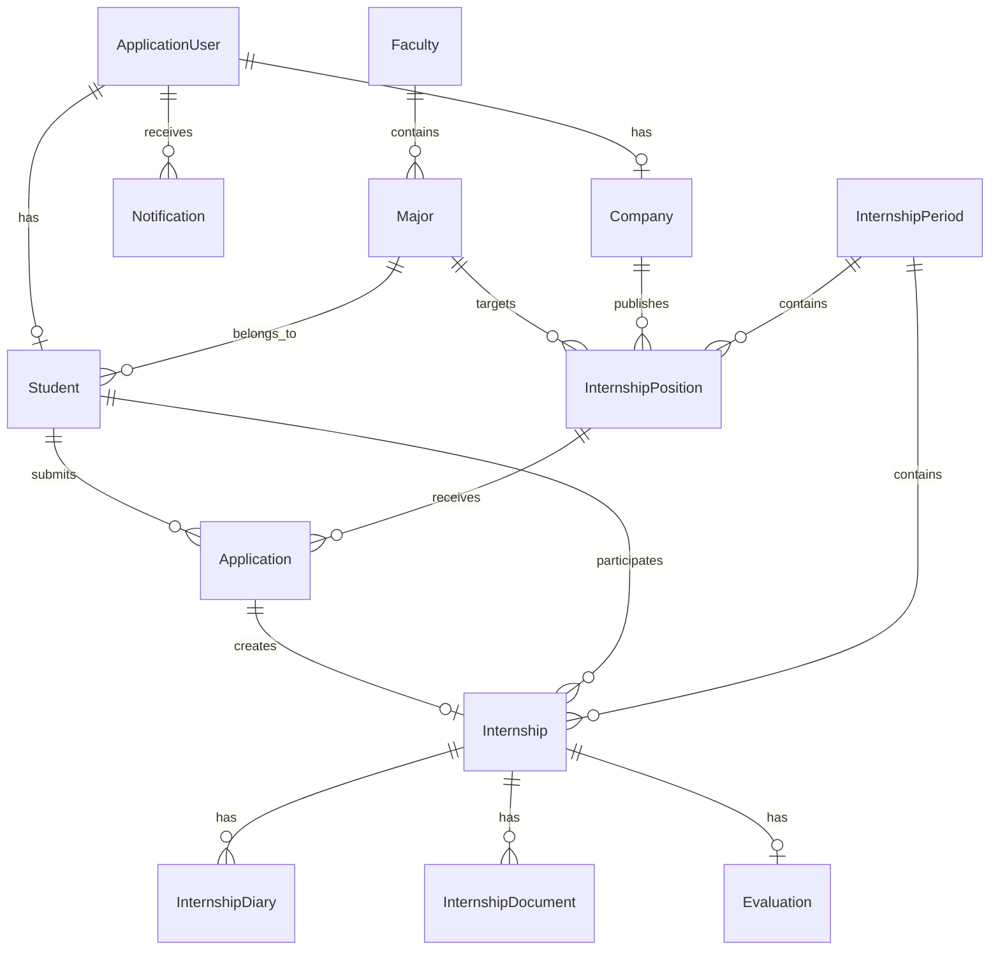

# Giai đoạn 3 — ERD và thiết kế database

## 1. Mục tiêu và phạm vi

Thiết kế database cho Cổng thông tin Thực tập và Kết nối Doanh nghiệp bằng SQL Server, Entity Framework Core 8 Code First và ASP.NET Core Identity.

Đây là tài liệu thiết kế để duyệt, chưa phải database hoặc Migration đã chạy. Không thay đổi schema Prisma hiện có.

- Tên database đã thống nhất: `InternshipPortalDb`.
- Dự án .NET dự kiến: `D:\Portal\code\InternshipPortal`.
- Có 12 bảng nghiệp vụ; không tính các bảng Identity.
- Không thêm bảng người hướng dẫn, kỹ năng hoặc lĩnh vực doanh nghiệp.

## 2. Quy tắc đã thống nhất

- Ba role: `Admin`, `Company`, `Student`.
- Company cần được Admin duyệt trước khi đăng vị trí.
- Sinh viên chỉ ứng tuyển một lần vào mỗi vị trí, kể cả đơn đã rút.
- Sinh viên chỉ được tiếp nhận một lần trong một đợt, kể cả hồ sơ đã kết thúc.
- Khi duyệt một đơn, tự hủy các đơn chưa kết thúc khác của sinh viên trong cùng đợt.
- Từ chối được thực hiện sau khi xem hồ sơ hoặc phỏng vấn, phải có lý do.
- Duyệt chỉ được thực hiện sau phỏng vấn.
- Sinh viên chỉ rút đơn Chờ duyệt.
- Mỗi hồ sơ thực tập có tối đa một đánh giá của doanh nghiệp.

## 3. Quy ước dữ liệu

- Các bảng nghiệp vụ dùng `Id int IDENTITY` làm Primary Key.
- `ApplicationUser` kế thừa `IdentityUser`, dùng `Id nvarchar(440)`.
- Foreign Key tới Identity dùng `nvarchar(440)`.
- Văn bản tiếng Việt dùng `nvarchar`; độ dài ghi trong bảng bên dưới.
- Theo yêu cầu bổ sung: không dùng kiểu chuỗi max; các độ dài đã chọn từ 220 trở lên giảm 10 một lần, tên file 255 đổi thành 200. Schema bên dưới đã cập nhật theo quy tắc này.
- Các ngày dùng `datetime2`, lưu UTC và hiển thị theo múi giờ Việt Nam. Quy ước hạn ứng tuyển phải được giải thích trên form khi lập trình.
- Các trạng thái và loại dữ liệu dùng enum C#, lưu số nguyên; gắn `Display(Name = "...")` cho giao diện.
- `CreatedAt datetime2 NOT NULL` có trên cả 12 bảng. Các bảng thường xuyên sửa có thêm `UpdatedAt datetime2 NULL`.
- Dấu `?` bên dưới chỉ cột được phép NULL; các cột khác bắt buộc.
- Không cấu hình Cascade Delete cho các quan hệ nghiệp vụ; dùng Restrict/NoAction.
- Danh mục và tài khoản đã phát sinh quan hệ được ngừng sử dụng thay vì xóa cứng.

## 4. Tài khoản Identity

`ApplicationUser` mở rộng tài khoản với `FullName nvarchar(150)`, `AvatarPath nvarchar(490)?`, `IsActive bit`, `CreatedAt datetime2`.

Email, số điện thoại, password hash, khóa tài khoản và role dùng cấu trúc Identity. Không lưu mật khẩu riêng trong Student hoặc Company.

Thiết lập Identity yêu cầu email duy nhất. Khi triển khai, bổ sung unique filtered index trên NormalizedEmail để database cũng bảo vệ tính duy nhất. Các bảng Identity mặc định được EF tạo qua IdentityDbContext.

Service đăng ký bảo đảm tài khoản Student chỉ có hồ sơ Student, tài khoản Company chỉ có hồ sơ Company; Admin không tự đăng ký. Unique UserId của từng bảng không tự bảo đảm quy tắc loại trừ giữa hai bảng, nên phải kiểm tra trong quy trình đăng ký.

## 5. Mười hai bảng nghiệp vụ

### 5.1. Students — Entity Student

| Cột | Kiểu SQL | Ý nghĩa |
|---|---|---|
| Id | int | PK |
| UserId | nvarchar(440) | FK tới AspNetUsers, unique |
| StudentCode | nvarchar(30) | MSSV, unique |
| MajorId | int | FK tới Majors |
| ClassName | nvarchar(50) | Lớp |
| Gpa | decimal(4,2)? | Điểm trung bình; thang điểm chốt trước khi làm form |
| CvPath | nvarchar(490)? | CV hiện tại; bắt buộc khi ứng tuyển |
| Skills | nvarchar(990)? | Kỹ năng |
| Bio | nvarchar(1990)? | Giới thiệu |

Không lưu FacultyId vì lấy khoa qua Major. Họ tên, email, điện thoại lấy từ tài khoản.

### 5.2. Companies — Entity Company

| Cột | Kiểu SQL | Ý nghĩa |
|---|---|---|
| Id | int | PK |
| UserId | nvarchar(440) | FK tới AspNetUsers, unique |
| Name | nvarchar(200) | Tên doanh nghiệp |
| TaxCode | nvarchar(30)? | Mã số thuế |
| Website | nvarchar(290)? | Website |
| Address | nvarchar(290) | Địa chỉ |
| BusinessField | nvarchar(150)? | Lĩnh vực hoạt động |
| Description | nvarchar(1990)? | Giới thiệu |
| ApprovalStatus | int | Pending, Approved, Rejected |
| ApprovalNote | nvarchar(990)? | Ghi chú duyệt hoặc từ chối |
| IsActive | bit | Đang hoạt động |

Không đặt unique Name vì doanh nghiệp có thể trùng tên. Chưa đặt unique TaxCode khi chưa thống nhất tài khoản theo pháp nhân.

### 5.3. Faculties — Entity Faculty

`Id int PK`, `Code nvarchar(20) UNIQUE`, `Name nvarchar(150)`, `IsActive bit`.

### 5.4. Majors — Entity Major

`Id int PK`, `FacultyId int FK → Faculties`, `Code nvarchar(20) UNIQUE`, `Name nvarchar(150)`, `IsActive bit`.

### 5.5. InternshipPeriods — Entity InternshipPeriod

`Id int PK`, `Code nvarchar(30) UNIQUE`, `Name nvarchar(150)`, `StartDate datetime2`, `EndDate datetime2`, `Status int`.

Status đề xuất: Planned — Chưa mở; Open — Đang mở; Closed — Đã đóng. Quyền ứng tuyển theo trạng thái đợt cần chốt trước khi lập trình, không tự suy ra từ thiết kế này.

### 5.6. InternshipPositions — Entity InternshipPosition

| Cột | Kiểu SQL | Ý nghĩa |
|---|---|---|
| Id | int | PK |
| Code | nvarchar(30) | Mã vị trí, unique |
| CompanyId | int | FK tới Companies |
| MajorId | int | FK tới Majors |
| InternshipPeriodId | int | FK tới InternshipPeriods |
| Title | nvarchar(200) | Tên vị trí |
| Description | nvarchar(2990) | Mô tả |
| Requirements | nvarchar(1990) | Yêu cầu |
| Quantity | int | Chỉ tiêu |
| Location | nvarchar(200) | Địa điểm |
| WorkMode | int | OnSite, Remote, Hybrid |
| StartDate | datetime2 | Ngày bắt đầu dự kiến |
| EndDate | datetime2 | Ngày kết thúc dự kiến |
| ApplicationDeadline | datetime2 | Hạn ứng tuyển |
| Status | int | Open, Closed |

Số người đã nhận tính từ Application Approved, không tạo cột AcceptedCount để tránh lệch dữ liệu.

### 5.7. Applications — Entity Application

`Id int PK`, `StudentId int FK → Students`, `InternshipPositionId int FK → InternshipPositions`, `CvPath nvarchar(490)`, `CoverLetter nvarchar(1990)?`, `Status int`, `Note nvarchar(1990)?`.

Unique `(StudentId, InternshipPositionId)` ngăn đơn trùng. Ngày ứng tuyển dùng CreatedAt.

CvPath tham chiếu bản CV tại thời điểm ứng tuyển. Không xóa file còn được đơn tham chiếu khi sinh viên đổi CV. Nếu dùng chung file vật lý, đường dẫn vẫn là bản chụp của đơn và file cũ phải được giữ.

Không lưu CompanyId vì lấy doanh nghiệp qua vị trí.

### 5.8. Internships — Entity Internship

`Id int PK`, `ApplicationId int FK → Applications UNIQUE`, `StudentId int FK → Students`, `InternshipPeriodId int FK → InternshipPeriods`, `SupervisorName nvarchar(150)?`, `SupervisorEmail nvarchar(246)?`, `SupervisorPhone nvarchar(30)?`, `StartDate datetime2`, `EndDate datetime2`, `Status int`.

Unique `(StudentId, InternshipPeriodId)` áp dụng cho mọi trạng thái, đúng quy tắc một lần tiếp nhận trong một đợt.

StudentId và InternshipPeriodId có thể suy ra qua đơn/vị trí nhưng được giữ để đặt ràng buộc unique này trực tiếp. ApplicationService phải lấy chúng từ dữ liệu liên quan, không nhận giá trị tùy ý từ form. FK riêng không tự bảo đảm các giá trị khớp nhau.

Không lưu CompanyId hoặc InternshipPositionId. Không lưu Progress khi chưa chốt công thức; dự kiến tính trong ViewModel.

### 5.9. InternshipDiaries — Entity InternshipDiary

`Id int PK`, `InternshipId int FK → Internships`, `WeekNumber int`, `StartDate datetime2`, `EndDate datetime2`, `WorkContent nvarchar(2990)`, `Results nvarchar(2990)`, `Difficulties nvarchar(2990)?`, `Note nvarchar(1990)?`.

Unique `(InternshipId, WeekNumber)`. Chưa thêm bảng phản hồi hoặc duyệt nhật ký vì chưa có yêu cầu quản lý độc lập.

### 5.10. InternshipDocuments — Entity InternshipDocument

`Id int PK`, `InternshipId int FK → Internships`, `DocumentType int`, `OriginalFileName nvarchar(200)`, `FilePath nvarchar(490)`, `FileSize bigint`.

DocumentType đề xuất: Report — Báo cáo; SupportingDocument — Tài liệu thực tập. CV hồ sơ và CV ứng tuyển nằm ở Students và Applications.

OriginalFileName chỉ dùng hiển thị, không dùng làm tên lưu file. File vật lý lưu dưới wwwroot/uploads bằng GUID, chặn truy cập trực tiếp và tải qua action kiểm tra quyền.

### 5.11. Evaluations — Entity Evaluation

`Id int PK`, `InternshipId int FK → Internships UNIQUE`, `ProfessionalKnowledge decimal(4,2)`, `WorkSkills decimal(4,2)`, `Attitude decimal(4,2)`, `Responsibility decimal(4,2)`, `Communication decimal(4,2)`, `TaskCompletion decimal(4,2)`, `Comment nvarchar(2990)`.

Mỗi điểm từ 0 đến 10. Điểm trung bình = tổng sáu điểm / 6, tính phía server; đề xuất hiển thị hai chữ số thập phân. Không lưu AverageScore và không nhận trường này từ form.

Doanh nghiệp đánh giá xác định qua Internship → Application → InternshipPosition → Company; chưa cần lưu EvaluatorRole vì chỉ có đánh giá doanh nghiệp.

### 5.12. Notifications — Entity Notification

`Id int PK`, `UserId nvarchar(440) FK → AspNetUsers`, `Type int`, `Title nvarchar(200)`, `Message nvarchar(1990)`, `TargetUrl nvarchar(490)?`, `DeduplicationKey nvarchar(200)?`, `IsRead bit`, `ReadAt datetime2?`.

Unique filtered index `(UserId, DeduplicationKey)` khi DeduplicationKey không NULL, chống trùng thông báo tự động. Thông báo thủ công có thể để khóa này NULL. TargetUrl chỉ chấp nhận đường dẫn nội bộ; trang đích vẫn kiểm tra quyền.

## 6. ERD

## 7. Enum và luồng trạng thái

| Enum | Các giá trị theo thứ tự |
|---|---|
| CompanyApprovalStatus | Pending = 0, Approved = 1, Rejected = 2 |
| InternshipPeriodStatus (đề xuất) | Planned = 0, Open = 1, Closed = 2 |
| InternshipPositionStatus | Open = 0, Closed = 1 |
| WorkMode | OnSite = 0, Remote = 1, Hybrid = 2 |
| ApplicationStatus | Pending = 0, Viewed = 1, Interviewed = 2, Approved = 3, Rejected = 4, Withdrawn = 5, Cancelled = 6 |
| InternshipStatus | NotStarted = 0, InProgress = 1, Completed = 2, Failed = 3 |
| DocumentType (đề xuất) | Report = 0, SupportingDocument = 1 |

NotificationType sẽ liệt kê các sự kiện trong mục 20 của tài liệu yêu cầu và Manual cho thông báo doanh nghiệp gửi. Khi triển khai phải gán giá trị số rõ ràng; không đổi ý nghĩa giá trị đã có trong database.

Không dùng so sánh số enum để kiểm tra bước chuyển. Service liệt kê các bước hợp lệ:

- Pending → Viewed hoặc Withdrawn.
- Viewed → Interviewed hoặc Rejected.
- Interviewed → Approved hoặc Rejected.
- Pending/Viewed/Interviewed → Cancelled chỉ do hệ thống xử lý các đơn còn lại khi có đơn được duyệt cùng đợt.
- NotStarted → InProgress → Completed hoặc Failed.

## 8. Index và Check Constraint

Unique index: các mã danh mục/vị trí, StudentCode, UserId của hồ sơ, cặp sinh viên/vị trí, ApplicationId của Internship, cặp sinh viên/đợt, cặp hồ sơ/tuần, InternshipId của Evaluation và khóa thông báo đã mô tả.

EF Core tạo index trên các FK theo quy ước. Bổ sung index phục vụ truy vấn:

- InternshipPositions `(Status, ApplicationDeadline)`.
- Applications `(InternshipPositionId, Status)`.
- Internships `(InternshipPeriodId, Status)`.
- Notifications `(UserId, IsRead, CreatedAt)`.

Check Constraint dự kiến:

- Quantity > 0.
- StartDate <= EndDate trên đợt, vị trí, hồ sơ và nhật ký.
- WeekNumber > 0.
- FileSize > 0.
- Sáu điểm đánh giá nằm trong [0, 10].
- Rejected Application phải có Note không rỗng.
- Enum chỉ nhận giá trị đã định nghĩa.

Các điều kiện liên bảng như chỉ tiêu, công ty đã duyệt, hạn ứng tuyển và trạng thái hồ sơ khi đánh giá được kiểm tra tại Service, không dùng Check Constraint tham chiếu bảng khác.

## 9. An toàn khi duyệt đơn đồng thời

ApplicationService thực hiện một transaction với mức cô lập Serializable và xử lý tranh chấp/deadlock phù hợp:

1. Đọc lại đơn, quyền sở hữu, trạng thái và vị trí.
2. Kiểm tra số đơn Approved của vị trí chưa đủ Quantity.
3. Kiểm tra chưa có Internship của sinh viên trong đợt.
4. Duyệt đơn, tạo Internship, hủy các đơn còn lại và tạo Notification.
5. SaveChanges và commit.

Unique index là lớp bảo vệ cuối cho hồ sơ trùng. Serializable bảo vệ phép kiểm tra chỉ tiêu, nhưng có thể phát sinh deadlock khi duyệt đồng thời; cần rollback, retry có giới hạn và kiểm tra lại điều kiện. Không trả thành công trước commit.

Việc giảm Quantity cũng cần kiểm tra số đã duyệt trong giao dịch phù hợp. Sẽ kiểm thử thực tế trên SQL Server ở giai đoạn triển khai, chưa tuyên bố đã xác minh tính đồng thời.

## 10. Những quyết định còn cần chốt trước khi code phần liên quan

- Thang điểm GPA là 4 hay 10.
- Có chặn ứng tuyển theo trạng thái đợt và có bắt buộc ngày vị trí nằm trong đợt không.
- Nhật ký đã chốt: chỉ tạo/sửa khi InProgress, tuần tính từng 7 ngày từ ngày bắt đầu; hồ sơ còn lại chỉ xem. Tài liệu nộp được khi InProgress/Completed/Failed; NotStarted chỉ xem.
- Cách tính tiến độ; đề xuất tỷ lệ tuần đã nộp nhật ký.
- CV đã chốt: PDF tối đa 10 MB. Tài liệu đã chốt: PDF/DOCX tối đa 10 MB.
- Quyền sửa đánh giá đã gửi và thao tác điều chỉnh của Admin.
- Thời điểm nhắc hạn; đề xuất trước 3 ngày, kiểm tra khi đăng nhập.

Không tự xem các đề xuất này là nghiệp vụ đã được xác nhận.

## 11. Checklist thiết kế

- [x] Đúng 12 bảng nghiệp vụ, không tính Identity.
- [x] Có PK, FK, độ dài và ngày tạo.
- [x] Có ràng buộc chống đơn trùng và tiếp nhận trùng đợt.
- [x] Tách vị trí, đơn ứng tuyển và hồ sơ thực tập.
- [x] Có enum và luồng trạng thái rõ ràng.
- [x] Không lưu mật khẩu riêng, file nhị phân hoặc điểm trung bình nhập tay.
- [x] Tránh Cascade Delete gây nhiều đường xóa trên SQL Server.
- [x] Nêu rõ dữ liệu lặp có chủ đích để đặt unique index.
- [ ] Entity, DbContext và Migration sẽ kiểm tra sau khi viết code.
- [ ] Database, seed và các tình huống đồng thời chưa được chạy.

## 12. Trạng thái dự án

Đã hoàn thành: tài liệu thiết kế ERD và database giai đoạn 3 để duyệt.

Đang thực hiện: chờ người dùng duyệt thiết kế; chưa tạo database, Entity hoặc Migration.

Bước tiếp theo: sau xác nhận và yêu cầu tiếp tục, giai đoạn 4 tạo ASP.NET Core MVC .NET 8; kiểm tra SDK, restore, build, chạy và kiểm tra trang chủ.
